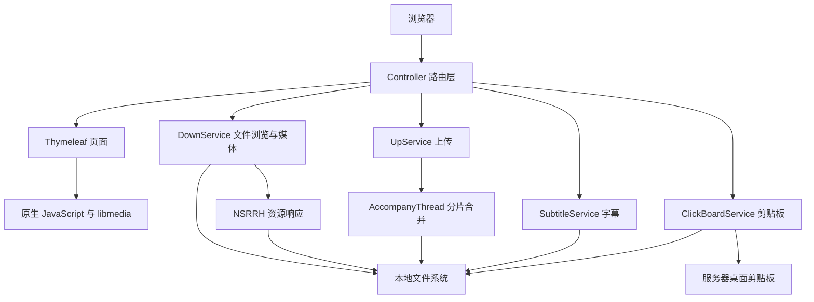
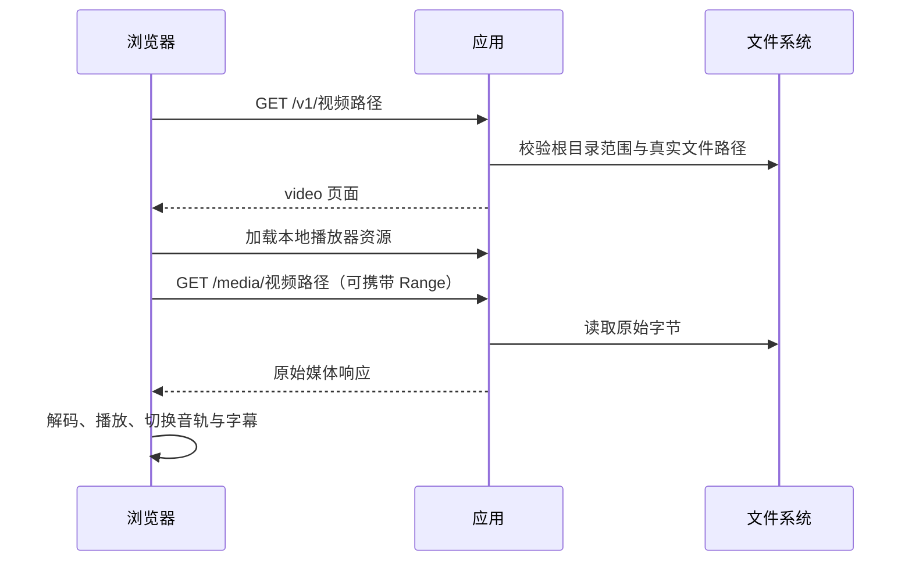

# 模块与架构

[返回项目首页](../README.md)

## 整体结构

这是一个服务端渲染页面的单体应用。后端处理请求、读写本地文件；浏览器负责上传队列、播放解码和交互。没有独立的前端开发服务器。

以下 Java 路径均相对于 `src/main/java/com/example/filerouter/`；页面和脚本相对于 `src/main/resources/`。

## 1. 文件浏览与下载

**职责**：展示共享目录，提供目录跳转和下载响应。

| 文件 | 职责 |
| --- | --- |
| `controller/FileController.java` | 将 `/` 重定向到文件列表，接收 `/f/**` 请求 |
| `service/DownService.java` | 判断目录或文件，生成列表、面包屑和父目录数据 |
| `utils/FileUtil.java` | 将文件写入 HTTP 响应，设置长度和下载文件名 |
| `templates/files.html` | 渲染目录、文件及预览入口 |
| `static/file-browser.js` | 手机面包屑展开、相对路径复制与 HTTP 环境复制备用方式 |

目录按中文排序规则排列，再将目录排在普通文件之前。列表显示文件名；面包屑与复制内容使用相对共享根目录的路径。

普通文件通过 `FileUtil.flushFile()` 返回。该方法对 `.html` 设置 `text/html`，其他文件设置附件下载头，因此不能把 `/f/**` 一概描述为强制下载。此路径不使用媒体接口的 Range 处理器。

目录分支进行了规范化路径检查，但普通文件下载与符号链接的处理没有完整复用媒体接口的真实路径校验，详见[已知限制](OPERATIONS.md#已知限制)。

## 2. 文件上传

**职责**：接收整文件或分片，写入上传目录，后台合并分片。

| 文件 | 职责 |
| --- | --- |
| `controller/FileController.java` | `/u` 页面和 `/upload` 接收入口 |
| `service/UpService.java` | 保存请求中的文件，按文件名管理上传任务，使用固定 20 线程的执行器 |
| `common/AccompanyThread.java` | 等待分片、依序合并、尝试清理临时文件与失败目标 |
| `utils/FileUtil.java` | 计算目标路径、临时目录和分片文件名，创建父目录 |
| `templates/upload.html`、`static/upload.js` | 队列、进度、移除、重试、分片调度与取消 |

默认前端协议：

1. 文件不超过 1 MiB（含空文件）时直接上传，不附带分片参数。
2. 大文件按 1 MiB 切片，先等待第 0 片请求成功。
3. 中间分片最多并发 4 个，全部成功后才发送最后一片。
4. 后端收到第 0 片时提交合并任务，收到最后一片时通知任务开始合并。
5. 前端按文件依次处理；失败文件重试时从第 0 片重新发送。

网络错误、请求超时、HTTP 408/429/5xx 最多自动重试两次；单次请求超时为 120 秒。队列拒绝同名文件，上传中禁止增删，离开页面会取消尚未完成的请求。

**完成语义**：HTTP 请求结束与后台合并结束是两个时刻。当前没有任务状态查询、文件校验和或合并完成回执；前端显示完成后仍需核对服务器目标文件。队列去重也不能阻止不同客户端上传同名文件。

## 3. 文件预览与视频播放

**职责**：提供统一预览入口、可按范围读取的媒体文件和浏览器播放器。

| 文件 | 职责 |
| --- | --- |
| `controller/FileController.java` | `/v1/**` 预览、`/v2/**` 旧链接重定向、`/media/**` 原始媒体 |
| `service/DownService.java` | 识别视频扩展名、校验真实文件路径、选择页面或文件响应 |
| `handler/NSRRH.java` | 从请求属性读取文件路径，交给资源处理器发送文件并支持 Range |
| `templates/video.html`、`static/video-player.js` | 初始化播放器、完整区域全屏、音轨与字幕、字幕关闭状态、跳转兼容、错误显示与销毁 |
| `static/mobile-player-controls.js`、`static/mobile-player.css` | 手机布局、控制栏、滑动进度、双击跳转、长按倍速、设置弹窗 |
| `static/libmedia/` | 随应用发布的播放器、动态模块和 WASM 资源 |

视频入口识别 MP4、MKV、WebM、M4V、MOV、AVI、RMVB。扩展名用于选择视频页面，不保证内部所有编码均可播放。图片、音频和 PDF 等由浏览器根据响应直接预览。

解码优先使用 MSE 原生路径，其次 WebCodecs，必要时使用 WASM。服务端不进行 FFmpeg 转码，也不生成 MP4 中间文件。视频响应使用 `Cache-Control: no-store`，页面退出时销毁播放器。

手机交互包括横滑调进度、进度条轻点和拖动、左右双击快退/快进 2 秒、长按临时 2 倍速、控制栏自动隐藏。长按倍速生效后锁定本次触摸，移动手指不会切换为进度拖动，松手恢复原倍速。

`fullscreenDom` 指向包含视频、控件和提示层的外层播放器，保证全屏时仍能显示倍速与进度提示。倍速提示背景为 50% 透明度，文字不透明。网页不提供竖滑调亮度或音量；部分浏览器可能另行提供原生视频手势。详细行为和解码限制见[视频与字幕专题](SUBTITLES.md)。

## 4. 字幕

**职责**：优先使用播放器字幕能力，为未识别内封字幕的 MP4 提供 Java 解析备用路径。

| 文件 | 职责 |
| --- | --- |
| `controller/SubtitleController.java` | 轨道元数据 JSON、WebVTT 响应、解析失败状态转换 |
| `service/SubtitleService.java` | 路径校验、MP4 tx3g 提取、时间轴转换、文本转义、内存缓存 |
| `static/video-player.js` | 检查播放器已有字幕轨道，必要时加载备用 WebVTT；补充“不使用字幕”菜单项并维护字幕开关状态 |

字幕开关在浏览器页面内维护，不新增后端接口或持久配置。选择“不使用字幕”停止字幕渲染，选择任一字幕轨道重新启用；播放、跳转或字幕列表更新后重新应用关闭状态。WASM 跳转重建播放器管线时，恢复音轨、字幕轨道和当前字幕开关状态。

字幕菜单由上游 UI 动态生成，页面通过 `MutationObserver` 在菜单重建后补充关闭选项。libmedia 1.3.1 会在发出 `played` 事件后启动字幕渲染，因此事件处理还需在微任务中再次应用关闭状态。销毁播放器时清理监听、观察器和补充菜单项。

Java 接口仅提取 MP4 tx3g 文本，支持时间轴编辑与 UTF-8/UTF-16 文本处理，不保留字体、颜色、位置或特效。MKV、ASS、图形字幕等能力由播放器模块决定。

缓存为最多 8 个文件的进程内 LRU，以文件大小和修改时间判断是否失效；重启后清空。实现限制单个字幕样本大小不超过 1 MiB，并对生成的 VTT 文本长度设置 `4 * 1024 * 1024` 上限；后者按 Java 字符串长度计数，不等同于整个缓存的字节大小。

WebVTT 响应设置 `no-store` 和 `nosniff`；轨道列表接口没有显式设置相同的缓存响应头。备用字幕加载失败时，视频仍可继续播放。

## 5. 剪贴板

**职责**：读取运行应用的服务器桌面会话中的剪贴板，将其内容显示给浏览器。

| 文件 | 职责 |
| --- | --- |
| `controller/ClickBoardController.java` | `/c` 页面、`/uptext` 文本接收、`/cbpn` 图片返回 |
| `service/ClickBoardService.java` | 使用 AWT 读取系统剪贴板，临时保存 PNG，记录提交文本 |
| `templates/click.html`、`static/clipboard.js` | 展示文本或图片、提交文本、复制到访问者浏览器剪贴板 |

读取时优先识别文本，其次图片。图片写入临时路径，访问 `/cbpn` 输出图片后尝试删除临时文件；该接口不是持久图片链接，也不是持续监控或实时同步。

需要区分三个方向：

- **服务器 → 页面**：读取服务器系统剪贴板文本或图片。
- **页面 → 访问者剪贴板**：浏览器复制显示的文本，提供局域网 HTTP 的备用方式。
- **页面 → 服务器**：`/uptext` 接收文本并记日志，目前没有设置服务器剪贴板。

启动类使用 `headless(false)`，但仍需可用的桌面环境。容器或无桌面服务器不能据此保证剪贴板功能可用。

## 6. 配置与公共组件

| 文件 | 职责 |
| --- | --- |
| `FileRouterApplication.java` | 应用启动，关闭 AWT headless 模式 |
| `common/FileProperties.java` | 绑定 `file.*` 配置 |
| `utils/FileUtil.java` | 初始化静态路径，生成上传临时路径，输出文件响应 |
| `common/CommandLineRunnerImpl.java` | 启动后输出根目录和推测的局域网 IP |
| `service/RootService.java` | 为继承它的服务提供日志对象，无统一业务流程 |

`FileUtil` 在初始化时生成共享路径；不是动态配置中心。启动日志中的 IP 来自网卡遍历和简单过滤，多网卡情况下应核对实际可访问地址。

## 维护与扩展位置

| 变更 | 通常涉及的位置 | 配套验证 |
| --- | --- | --- |
| 修改列表或面包屑 | `DownService`、`files.html`、`file-browser.js` | `FileBrowsingTest`、`file-browser.test.cjs` |
| 修改上传协议 | `FileController`、`UpService`、`AccompanyThread`、`upload.js` | `native-upload.test.cjs`，补充后端合并验证 |
| 修改视频入口或媒体输出 | `FileController`、`DownService`、`NSRRH` | `PreviewRoutingTest` |
| 修改播放与手机交互 | `video-player.js`、`mobile-player-controls.js`、对应样式 | 播放器与手机控件 JS 测试、真实浏览器回归 |
| 修改字幕解析 | `SubtitleService`、`SubtitleController` | `SubtitleServiceTest` |
| 完善剪贴板写入 | `ClickBoardService`、`clipboard.js` | 前端请求测试与服务器桌面环境实测 |

变更后同步更新[接口说明](API.md)、[运行与维护](OPERATIONS.md)及相关专题，避免页面提示、接口契约与实际完成状态不一致。
